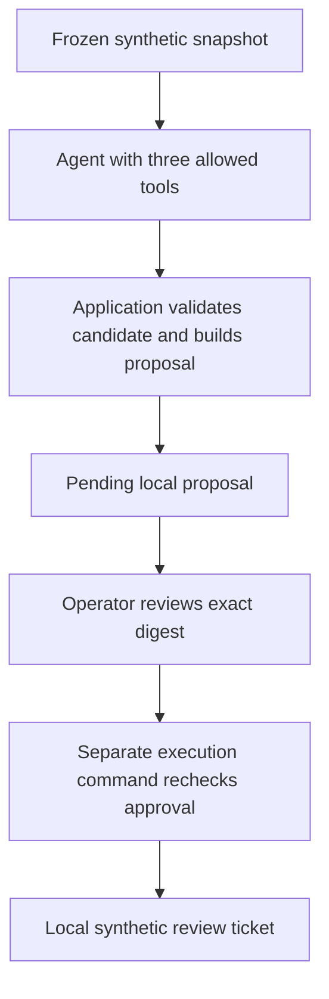
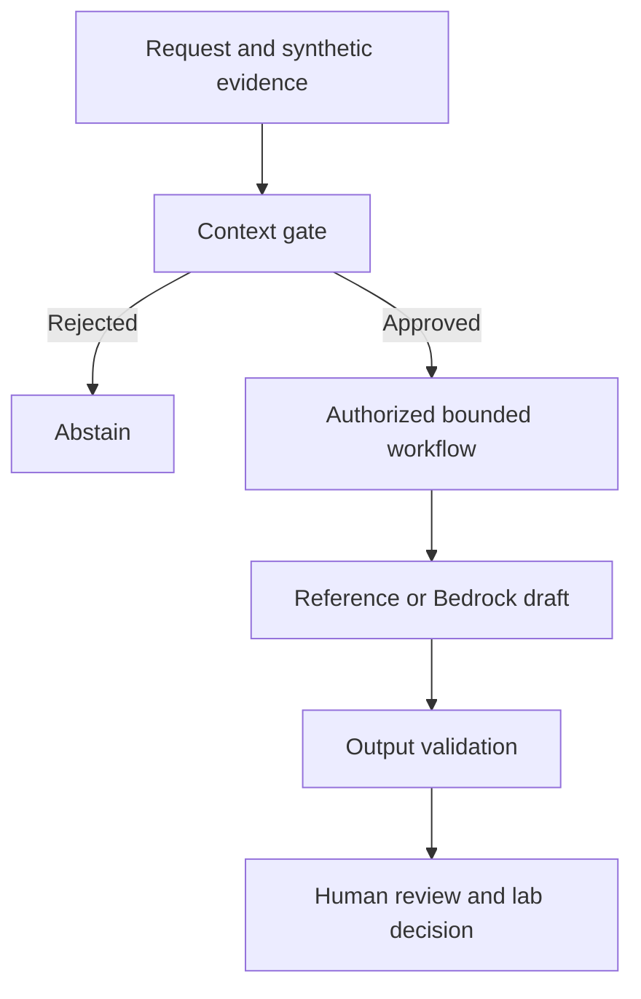

# Agentic Security Workflow

## New: AI Security Program Control Tower

The [control tower](docs/control-tower.md) adds synthetic finding and vendor-risk intake,
NIST control mappings, bounded AI drafting, exact-payload human decisions,
dependency-aware remediation tickets, executive reports, and verifiable evidence exports.
Run locally with Python or use the optional DynamoDB/S3 storage implementation.
Private DynamoDB/S3 storage was deployed and smoke-tested on November 3, 2026;
live model validation remains pending and the existing blocked AI quality decision
below is preserved. See the [AWS deployment record](docs/control-tower-aws.md).
The [validation record](docs/control-tower-validation.md) distinguishes completed
local checks from pending cloud and publication steps.

A bounded security-review workflow that turns a frozen synthetic threat-intel
snapshot into a proposed local ticket, with explicit human approval before
execution. A separate Project 4 companion evaluates AI drafting quality.

> **Evaluation outcome: BLOCKED.** Both tested configurations passed 36/36
> structural contract checks but only 9/12 human draft reviews against a 12/12
> requirement. Across 24 model calls, neither configuration was eligible.
> See the [final laboratory decision](docs/p4-final-results.md).

## Problem and personal contribution

How can an AI assistant help draft a security review without receiving approval
or execution authority, and how can measured quality prevent premature adoption?

In this personal project, I built the bounded tool interface, application-owned
ticket fields, digest-bound local approval flow, and negative tests. For the
evaluation companion, I implemented context and output checks, reliability
fixtures, a two-configuration comparison, and a documented quality-gate decision.
Human judgments are self-attested; they are not independent validation.

## Architecture: security workflow

The model can call `list_candidates`, `get_candidate`, and `propose_ticket`.
It has no approval, execution, shell, email, or AWS administration tool.
Application code selects the highest-ranked candidate and supplies authoritative
asset, owner, score, and applicability fields. Approval expires after 24 hours;
execution rechecks the payload and reuses the same matching ticket on repeat.

## Implemented controls and workflow evidence

| Control or question | Implementation or recorded evidence |
| --- | --- |
| Allowed tools and bounded evidence | [Tool controller](app/tools.py), [agent](app/agent.py) |
| Proposal integrity and human approval | [Workflow implementation](app/workflow.py), [approval verification](docs/approval-verification.md) |
| Rejection and repeat behavior | [Security tests](tests/test_security.py) |
| Trust assumptions and injected evidence example | [Workflow boundaries](docs/boundaries.md), [recorded attack example](docs/evaluation.md) |

These are author-recorded exercises and committed checks, not independently
rerun results from this documentation review.

## Separate companion: AI evaluation and reliability

Project 4 evaluates bounded synthetic drafting. It does not validate integration
with `app.agent` / `app.workflow`, model-driven planning, or production deployment.

| Configuration | Contract checks | Human draft review | Eligible |
| --- | ---: | ---: | --- |
| temperature-0 | 36/36 | 9/12 | No |
| temperature-0.5 | 36/36 | 9/12 | No |

The 72 contract checks include 48 policy-only checks and 24 model responses;
they are not 72 model calls. Structural success did not satisfy the human-quality
gate. The decision criteria were set retrospectively in session 8, and the
development dataset was used during prompt improvement.

- [Measured comparison](docs/p4-lesson5-results.md) and [CI evidence](docs/p4-lesson6-results.md)
- [Human judgments and rationales](docs/p4-lesson7-results.md)
- [Final decision](docs/p4-final-results.md) and [governance matrix](docs/p4-governance-matrix.md)
- [Dashboard HTML: download and open locally](docs/p4-dashboard.html)
- [Operations runbook](docs/p4-operations-runbook.md) and [demo guide](docs/p4-demo-guide.md)

## Limitations

- The workflow trusts the local OS user and editable approval records. It is
  a single-operator demonstration, with no immutable audit or independent approver.
- The operator's AWS SSO profile has administrator privileges. A model-facing
  tool allowlist does not make that runtime identity least-privilege.
- Evidence is frozen and synthetic; applicability and patch status need review.
- One recorded injection example does not establish comprehensive resistance.
- The companion uses a small development dataset and one reviewer. Its review
  rationales are brief, and its quality decision remains blocked.
- Durable concurrent idempotency and production integration remain untested.
- Governance mappings are lab analogies, not compliance or readiness certification.

## Next validation

Resolve failed draft judgments and reevaluate using a larger independently
held-out dataset, a prespecified rubric, and an independent reviewer. Validate
workflow integration, durable concurrency behavior, and a scoped runtime role
before considering broader use. Keep the blocked decision until new evidence
supports a different outcome.
