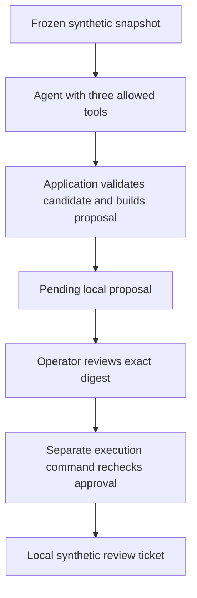
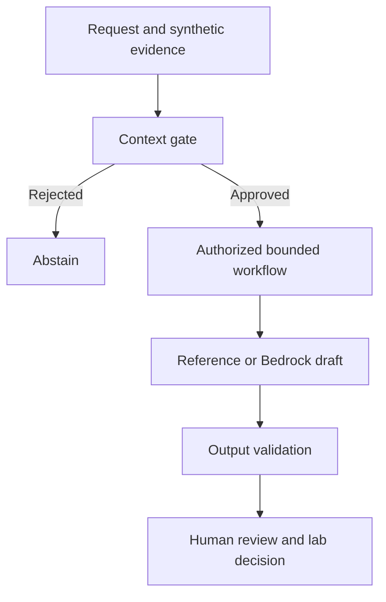

# Agentic Security Workflow

[Portfolio overview](https://github.com/SushiBear21/agentic-security-workflow/blob/main/PORTFOLIO.md) · [Latest CI runs](https://github.com/SushiBear21/agentic-security-workflow/actions)

**AI security engineering, human approval, evaluation, and program delivery.**

Start with the [portfolio overview](PORTFOLIO.md) for all four repositories or the
[10-minute walkthrough](docs/portfolio/walkthrough.md) for a guided review.

| Explore | Evidence |
| --- | --- |
| Security program delivery | [Control Tower](docs/control-tower.md) and [delivery case study](docs/portfolio/ai-program-delivery-case-study.md) |
| Deployment engineering | [Container, approval and rollback workflow](docs/portfolio/deployment-automation.md) |
| Federal control evidence | [Synthetic SSP](docs/portfolio/synthetic-ssp.md), [POA&M](docs/portfolio/poam.json), [monitoring](docs/portfolio/continuous-monitoring.md) |
| Measured AI quality | [Blocked evaluation decision](docs/p4-final-results.md) |
| Verification | [Latest implementation validation](docs/portfolio/completion-validation.md) and [CI runs](https://github.com/SushiBear21/agentic-security-workflow/actions) |

**Scope:** personal portfolio using synthetic data. Passing engineering checks does
not clear the blocked AI-quality decision or establish production readiness.

## Program and governance demonstrations

- [AI program-delivery case study](docs/portfolio/ai-program-delivery-case-study.md)
- [Selected-control FedRAMP readiness exercise](docs/portfolio/fedramp-readiness-lab.md)
- [Synthetic AWS continuous monitoring](docs/portfolio/aws-conmon-synthetic.md)
- [Privileged-access simulation](docs/privileged-access-demo.md)

These additions preserve the existing blocked AI-quality decision. They do not
claim FedRAMP authorization or implement production IAM. No new AWS deployment
is required. Run the offline evidence builder with `python -m tower.readiness_package
--output /tmp/readiness-evidence-new` (on one line, using a new directory).

## AI Security Program Control Tower

The [control tower](docs/control-tower.md) adds synthetic finding and vendor-risk intake,
NIST control mappings, bounded AI drafting, exact-payload human decisions,
dependency-aware remediation tickets, executive reports, and verifiable evidence exports.
Run locally with Python or use the optional DynamoDB/S3 storage implementation.
Private DynamoDB/S3 storage was deployed and smoke-tested on November 3, 2026;
live model validation remains pending and the existing blocked AI quality decision
below is preserved. See the [AWS deployment record](docs/control-tower-aws.md).
The [validation record](docs/control-tower-validation.md) distinguishes completed
local checks from pending cloud and publication steps.

A bounded security-review workflow that turns a frozen synthetic threat-intel
snapshot into a proposed local ticket, with explicit human approval before
execution. A separate Project 4 companion evaluates AI drafting quality.

> **Evaluation outcome: BLOCKED.** Both tested configurations passed 36/36
> structural contract checks but only 9/12 human draft reviews against a 12/12
> requirement. Across 24 model calls, neither configuration was eligible.
> See the [final laboratory decision](docs/p4-final-results.md).

## Problem and personal contribution

How can an AI assistant help draft a security review without receiving approval
or execution authority, and how can measured quality prevent premature adoption?

In this personal project, I built the bounded tool interface, application-owned
ticket fields, digest-bound local approval flow, and negative tests. For the
evaluation companion, I implemented context and output checks, reliability
fixtures, a two-configuration comparison, and a documented quality-gate decision.
Human judgments are self-attested; they are not independent validation.

## Architecture: security workflow

The model can call `list_candidates`, `get_candidate`, and `propose_ticket`.
It has no approval, execution, shell, email, or AWS administration tool.
Application code selects the highest-ranked candidate and supplies authoritative
asset, owner, score, and applicability fields. Approval expires after 24 hours;
execution rechecks the payload and reuses the same matching ticket on repeat.

## Implemented controls and workflow evidence

| Control or question | Implementation or recorded evidence |
| --- | --- |
| Allowed tools and bounded evidence | [Tool controller](app/tools.py), [agent](app/agent.py) |
| Proposal integrity and human approval | [Workflow implementation](app/workflow.py), [approval verification](docs/approval-verification.md) |
| Rejection and repeat behavior | [Security tests](tests/test_security.py) |
| Trust assumptions and injected evidence example | [Workflow boundaries](docs/boundaries.md), [recorded attack example](docs/evaluation.md) |

These are author-recorded exercises and committed checks, not independently
rerun results from this documentation review.

## Separate companion: AI evaluation and reliability

Project 4 evaluates bounded synthetic drafting. It does not validate integration
with `app.agent` / `app.workflow`, model-driven planning, or production deployment.

| Configuration | Contract checks | Human draft review | Eligible |
| --- | ---: | ---: | --- |
| temperature-0 | 36/36 | 9/12 | No |
| temperature-0.5 | 36/36 | 9/12 | No |

The 72 contract checks include 48 policy-only checks and 24 model responses;
they are not 72 model calls. Structural success did not satisfy the human-quality
gate. The decision criteria were set retrospectively in session 8, and the
development dataset was used during prompt improvement.

- [Measured comparison](docs/p4-lesson5-results.md) and [CI evidence](docs/p4-lesson6-results.md)
- [Human judgments and rationales](docs/p4-lesson7-results.md)
- [Final decision](docs/p4-final-results.md) and [governance matrix](docs/p4-governance-matrix.md)
- [Dashboard HTML: download and open locally](docs/p4-dashboard.html)
- [Operations runbook](docs/p4-operations-runbook.md) and [demo guide](docs/p4-demo-guide.md)

## Limitations

- The workflow trusts the local OS user and editable approval records. It is
  a single-operator demonstration, with no immutable audit or independent approver.
- The operator's AWS SSO profile has administrator privileges. A model-facing
  tool allowlist does not make that runtime identity least-privilege.
- Evidence is frozen and synthetic; applicability and patch status need review.
- One recorded injection example does not establish comprehensive resistance.
- The companion uses a small development dataset and one reviewer. Its review
  rationales are brief, and its quality decision remains blocked.
- Durable concurrent idempotency and production integration remain untested.
- Governance mappings are lab analogies, not compliance or readiness certification.

## Next validation

Resolve failed draft judgments and reevaluate using a larger independently
held-out dataset, a prespecified rubric, and an independent reviewer. Validate
workflow integration, durable concurrency behavior, and a scoped runtime role
before considering broader use. Keep the blocked decision until new evidence
supports a different outcome.

## November 2026 portfolio extensions

See [customer deployment and release rehearsal](docs/portfolio/customer-deployment.md) for commands, measured scope and limitations.

- [Evidence-bound assurance and risk exceptions](docs/portfolio/assurance-workflow.md)
- [Versioned evaluation and reliability](docs/portfolio/evaluation-extensions.md)
- [Current validation record](docs/portfolio/validation-2026-11-15.md)

## Deployment, compliance evidence, and adoption

- [Synthetic SSP](docs/portfolio/synthetic-ssp.md) and [tracked POA&M](docs/portfolio/poam.json)
- [Staging build/publish/deploy and rollback](docs/portfolio/deployment-automation.md)
- [Adoption measurement and handoff](docs/portfolio/adoption-measurement.md)
- [Read-only AWS collection and evidence freshness](docs/portfolio/continuous-monitoring.md)

Container CI now scans OS and library vulnerabilities and generates image SBOMs.
AWS publishing/deployment workflows are manual and require configured protected
environments and existing infrastructure. No live deployment or real adoption
results are implied; the AI-quality gate remains blocked.
