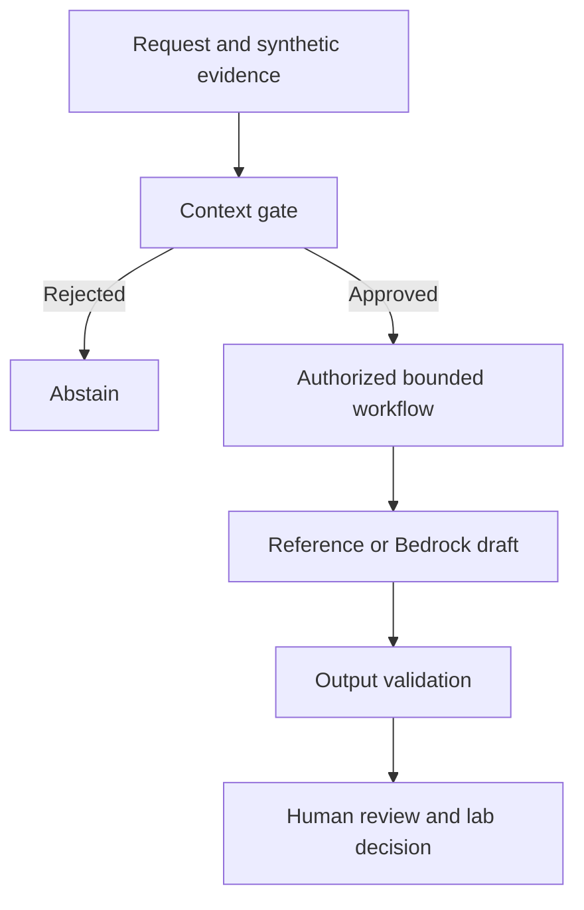

# Agentic Security Workflow

## Project 4: AI evaluation and reliability

A bounded synthetic drafting companion with regression checks,
a measured two-configuration model comparison, human review,
governance evidence, and a documented local readiness decision.

- [Measured model comparison](docs/p4-lesson5-results.md)
- [CI evidence](docs/p4-lesson6-results.md)
- [Human review](docs/p4-lesson7-results.md)
- [Governance matrix](docs/p4-governance-matrix.md)
- [Final decision and comparison](docs/p4-final-results.md)
- [Dashboard HTML - download and open locally](docs/p4-dashboard.html)
- [Operations runbook](docs/p4-operations-runbook.md)
- [Demonstration guide](docs/p4-demo-guide.md)

This is a laboratory evaluation companion.
Read the final decision and remaining risks before interpreting
its results as readiness for any broader use.
