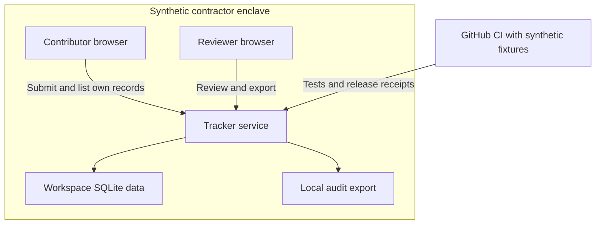

# CMMC Level 2 tracker exercise

## SSP extract and boundary

**System owner:** Aster Ridge Engineering, a fictional defense contractor.
**Purpose:** Accept and review synthetic evidence notes in a controlled
engineering workflow. The test records are invented stand-ins for CUI.
This lab uses the requested NIST SP 800-171 Rev. 2 baseline and assesses
selected objectives. No real CUI, customer systems, or certification claim is
within the scope.

The local workstation, browser, service, token provisioning file, workspace
database and export are in scope for the exercise. GitHub CI receives source and
synthetic fixture evidence. Lab tokens stay local or ephemeral within CI.
Production identity, endpoint administration, real email and external storage
are outside this boundary. Access is scoped by workspace and role. Submitted
evidence is digest-bound to the reviewer decision. Successful submit, review,
and export events are linked by hash. Logs share the application's trust
boundary and are suitable for the scope of the exercise.

## Selected assessment objectives

| Rev. 2 requirement | Selected objective and method | Evidence and limitations |
| --- | --- | --- |
| **3.1.2** | Define permitted transactions and exercise enforcement. Examine the role policy and test one permitted reviewer action and denied contributor review. | `tracker/store.py`, role denial, and empty cross-workspace list in the generated exercise. Device and service-account samples are outside this test. |
| **3.3.2** | Trace successful operations to named system users. Examine the audit event fields, then test that submit, review, and export are traceable to the configured lab principals. | Generated event chain and digest. The exercise covers the three workflow events and static lab identities. |
| **3.4.3** | Examine evidence of change review and approval, then test the approval association. | Finding F-001 and retest in the synthetic change record. The CI release workflow records technical eligibility and has a separate human approval step. |

## Finding and retest

**F-001 — Missing review evidence.** The synthetic baseline change record has
a candidate hash and no approver. The acceptance check fails. The fictional
change manager owns remediation, which requires a designated independent
reviewer and an approval record tied to the candidate. Replaying the check
with that record passes. Reusing it for a changed candidate fails. The exercise
preserves both versions and both SHA-256 hashes.

Run `python -m tracker.assessment --output .local/cmmc-exercise.json` to
produce the finding, first test, corrective action, retest, and tracker audit
events. The test performs real local tracker operations using fictional data.
The change approval record and approver role are fixtures. Every other
assessment objective remains outside this selected sample.

[DoD CMMC Level 2 assessment guide](https://dodcio.defense.gov/Portals/0/Documents/CMMC/AssessmentGuideL2v2.pdf) ·
[NIST SP 800-171A historical assessment procedures](https://csrc.nist.gov/pubs/sp/800/171/a/final)
